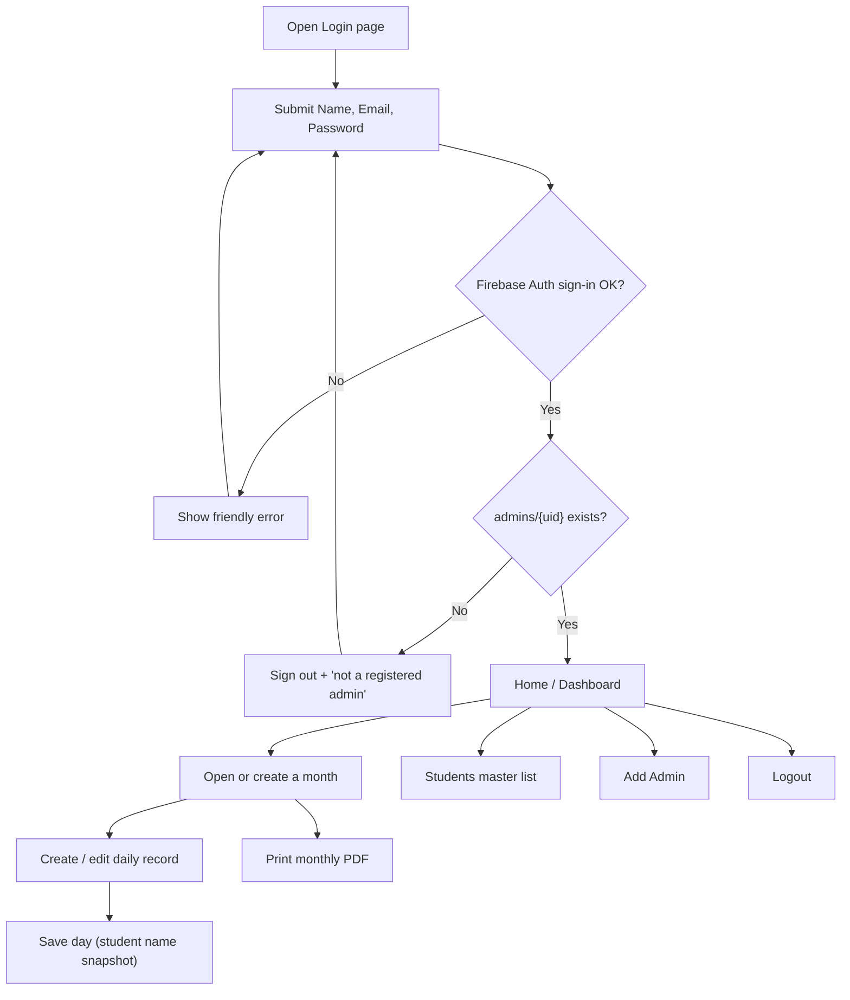

# Student Work Aid Attendance — Product Requirements Document (PRD)

## 1. Product Overview

A private, admin-only web app that replaces the supervisor's paper process for recording which
students attended the school's "work aid" program each day. It stores daily attendance records
organised by month, keeps a reusable master student list, and exports a printable monthly
attendance sheet as a PDF.

- **Problem solved**: manual paper sign-in sheets that are hard to archive, search, or summarise by month.
- **Target users**: a small number of school staff (admins). One admin is the supervisor.
- **Value**: fast daily entry via a reusable student checklist, reliable monthly history, and a
  one-click, hand-in-ready monthly PDF.

## 2. Core Features

### 2.1 User Roles

| Role | Registration Method | Core Permissions |
|------|---------------------|------------------|
| Admin | Created by an existing admin on the **Add Admin** page, or manually created in the Firebase Console (the very first admin) | Sign in; manage students; create/edit/delete daily & monthly records; add other admins; print monthly PDF |
| Non-admin (any other Firebase user) | n/a | Cannot enter the app. On login they see: "This account is not a registered admin." |

> Only email/password accounts that also have a document under the `admins` Firestore collection may use the app.

### 2.2 Feature Module

1. **Login page (`index.html`)**: brand panel + login form (Name, Email, Password), validation, friendly errors.
2. **Home / Dashboard (`dashboard.html`)**: two large cards — *Stored Records* (list of saved months) and *Add Monthly Record* (choose month + year).
3. **Month page (`month.html`)**: list of recorded days in the selected month (view/edit/delete), *Create Daily Record* (date picker + student checkboxes with Select all / Clear all / search), and a *Print Record* button.
4. **Students page (`students.html`)**: master list — add, edit, delete, search; used as the daily checklist source.
5. **Add Admin page (`add-admin.html`)**: register a new admin (name, email, password). Admin-only.
6. **About page (`about.html`)**: short description of the program and how to use the app.
7. **Shared navigation**: top bar with logo + Home, Students, About, Add Admin, Logout; collapses to a hamburger menu on mobile.

### 2.3 Page Details

| Page Name | Module Name | Feature description |
|-----------|-------------|---------------------|
| Login (`index.html`) | Brand panel | School logo placeholder (`images/logo.png`), program name, short tagline. Two-column on laptop, stacked on mobile. |
| Login (`index.html`) | Login form | Name, Email, Password fields + Login button. Validates empty fields, shows "wrong password"/"user not found" and "This account is not a registered admin." messages. Loading indicator while signing in. Redirects to `dashboard.html` on success. |
| Home (`dashboard.html`) | Stored Records card | Grid/list of all saved months (e.g. "November 2026") with the number of recorded days. Clicking a month opens `month.html?m=YYYY-MM`. Empty state when no months exist. |
| Home (`dashboard.html`) | Add Monthly Record card | Month dropdown + year input/select, "Create month" button. Prevents duplicate months and tells the user if it already exists. |
| Home (`dashboard.html`) | Session guard | If not signed in / not an admin, redirect to login. Greeting uses the logged-in admin's name. |
| Students (`students.html`) | Master list | Add student (name only), inline edit, delete (with confirm). Search box filters live. Shows created date. |
| Students (`students.html`) | Data integrity | Deleting a student does NOT change past attendance records (records store a name snapshot). |
| Month (`month.html`) | Header | Shows "Month Year" title and the month navigation context. |
| Month (`month.html`) | Days of Recorded Months | List of recorded dates (e.g. "21 November 2026") with attendee count. Click to expand/view the list of student names. Edit (re-tick students) and Delete (with confirm). |
| Month (`month.html`) | Create Daily Record | Date picker constrained to the month; loads student checkboxes with Select all / Clear all / search. On save, warns if a record already exists for that date and offers to edit it instead. |
| Month (`month.html`) | Print Record | Generates a landscape A4 PDF: student names as rows, dates of the month as columns, ✓ in attended cells. Title header (school name, program name, month/year) and a supervisor name + signature area at the bottom. |
| Add Admin (`add-admin.html`) | Register admin | Name, Email, Password (+ confirm). Creates a Firebase auth user and writes `admins/{uid}`. Success/error messages. Admin-only. |
| About (`about.html`) | Info | Program description, how records are organised, privacy note. |

## 3. Core Process

**Sign-in & access control**
1. User opens `index.html` and submits Name, Email, Password.
2. Firebase Auth signs the user in with email + password.
3. App checks Firestore `admins/{uid}`. If missing → sign out + show "This account is not a registered admin." If present → go to Home.

**Daily recording**
1. Admin logs in → Home → opens a month (or creates it).
2. Month page → *Create Daily Record* → pick a date inside the month → tick students from the master list → Save.
3. The day is stored under the month; it appears in *Days of Recorded Months* and can be edited/deleted.

**Monthly export**
1. On a month page, click *Print Record* → jsPDF + autoTable build the attendance grid → PDF downloads.

## 4. User Interface Design

### 4.1 Design Style

- **Direction**: calm, precise, "institutional clarity" — generous white space, crisp type, a single
  confident accent colour. Feels like a well-made modern admin tool, not a generic template.
- **Primary colour**: ink-teal accent (changeable via CSS variables).
- **Secondary colour**: warm neutral surface / off-white background with soft borders.
- **Buttons**: rounded (10–12px radius), solid accent for primary actions, ghost/outline for secondary.
- **Cards**: white surface, 16px radius, soft layered shadow, 1px subtle border.
- **Typography**: display font **Fraunces** for headings (characterful, warm, academic) paired with
  **Manrope** for body/UI text. Both from Google Fonts.
- **Layout**: top navigation bar + centred content container (max-width), card-based modules.
- **Icon/emoji style**: minimal inline SVG line icons (no emoji in the UI).
- **Motion**: subtle page-load fade/slide, hover lift on cards, focus rings on inputs, toast messages.

### 4.2 Page Design Overview

| Page Name | Module Name | UI Elements |
|-----------|-------------|-------------|
| Login | Split layout | Left: accent-tinted panel with logo + program name. Right: white form card. Stacks to single column < 900px. Inline field errors, loading spinner on the button. |
| Dashboard | Two hero cards | Large clickable cards with icon, title, description, hover lift. Stored Records = month chips/grid. Add Monthly Record = month/year selects + primary button. |
| Students | Master list | Search bar, "Add student" inline form, list rows (name, date, edit/delete), empty state, toast confirmations. |
| Month | Recorded days + create | Recorded-days accordion list; create-record card with date input, sticky checklist toolbar (search + Select all + Clear all), scrollable checkbox list; Print button in the header. |
| Add Admin | Form card | Name/Email/Password/Confirm fields, validation, success banner. |
| About | Article card | Short formatted content, brand logo. |

### 4.3 Responsiveness

Desktop-first. Content container adapts; the login page uses a 2-column grid that collapses to 1
column under 900px. The top navigation collapses into a hamburger menu under 768px (with an
accessible toggle). Touch targets ≥ 44px. Tables/lists become stacked cards on mobile. The
checklist grid reflows to one column on small screens.

### 4.4 3D Scene Guidance

Not applicable — this is a data/CRUD admin application.
