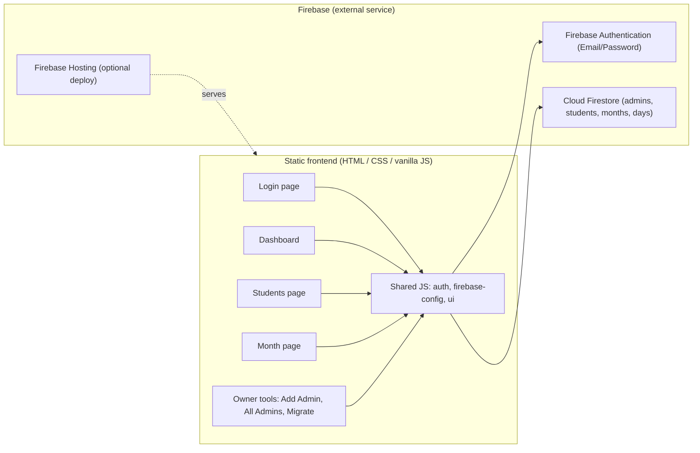
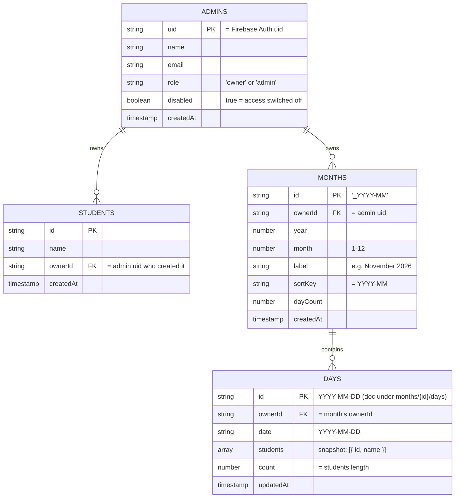

# Student Work Aid Attendance — Technical Architecture

## 1. Architecture Design



All pages are static files. The Firebase **web SDK (v13.2.0, ES module)** is loaded from the
`gstatic` CDN via `<script type="module">`. No build step, no bundler, no framework.

## 2. Technology Description

* **Frontend**: plain HTML5 + CSS3 (custom properties) + vanilla JavaScript (ES modules). **No React, no build tools** — per the user's explicit request.

* **Initialization Tool**: none (hand-written static files).

* **Backend**: Firebase Authentication (Email/Password) + Cloud Firestore.

* **Database**: Cloud Firestore (NoSQL documents/collections).

* **PDF generation**: `jsPDF` + `jspdf-autotable` from CDN (chosen over a print stylesheet because the
  requirement is a *downloadable* PDF — see rationale in §7).

* **Fonts**: Google Fonts — **Fraunces** (display) + **Manrope** (body).

* **Icons**: inline SVG.

* **Hosting**: Firebase Hosting (or Netlify) — both free.

### File Structure

```
studentWorkAid/
├─ index.html            # Login page (first page visitors see)
├─ dashboard.html        # Home / admin dashboard
├─ students.html         # Master student list
├─ month.html            # Single month page (day records + create + print)
├─ add-admin.html        # Add / disable / remove admins (owner-only)
├─ all-admins.html       # Browse every admin's data (owner-only)
├─ migrate.html          # One-time migration tool (owner-only)
├─ about.html            # About page
├─ images/
│  └─ logo.png           # Placeholder school logo (replace with your own)
├─ css/
│  └─ style.css          # All styles; colour tokens as CSS variables at the top
└─ js/
   ├─ firebase-config.js # Firebase init + exported auth/db handles
   ├─ auth.js            # Sign in/out, admin + role check, page guard
   ├─ ui.js              # Shared UI helpers: nav, toasts, loading, formatting
   ├─ students.js        # Students page logic
   ├─ months.js          # Dashboard: list months + create month
   ├─ month.js           # Month page: days list, create/edit/delete day
   ├─ admins.js          # Owner tooling: add/disable/remove admins + browse all
   ├─ migrate.js         # One-time migration of pre-ownerId data
   └─ pdf.js             # Monthly attendance PDF (jsPDF + autoTable)
```

## 3. Route Definitions

Multi-page app (real files, not a SPA router):

| Route                   | Purpose                                                                 |
| ----------------------- | ----------------------------------------------------------------------- |
| `/index.html`           | Login page (public). Redirects to `dashboard.html` if already an admin. |
| `/dashboard.html`       | Home; Stored Records list + Add Monthly Record. Admin-only.             |
| `/students.html`        | Master student list (add/edit/delete/search). Admin-only.               |
| `/month.html?id=<docId>`| One month: recorded days, create daily record, print PDF. Admin-only. Read-only when the owner views another admin's month. |
| `/add-admin.html`       | Add / disable / remove admins. **Owner-only.**                          |
| `/all-admins.html`      | Browse every admin's students + months (read-only). **Owner-only.**     |
| `/migrate.html`         | Temporary one-time migration tool. **Owner-only.**                      |
| `/about.html`           | About the program. Admin-only.                                          |
| `/logout` (action)      | Sign out via Firebase Auth, then return to `index.html`.                |

## 4. API Definitions

No custom backend API. The app talks to Firebase directly through the SDK:

| Operation               | Firebase call                                                                     |
| ----------------------- | --------------------------------------------------------------------------------- |
| Sign in                 | `signInWithEmailAndPassword(auth, email, password)`                               |
| Sign out                | `signOut(auth)`                                                                   |
| Create admin user       | `createUserWithEmailAndPassword(auth, email, password)` then write `admins/{uid}` |
| Check admin / role      | `getDoc(doc(db, 'admins', uid))` → `role`, `disabled`                             |
| List my students        | `onSnapshot(query(collection(db, 'students'), where('ownerId', '==', uid)))`      |
| Add/edit/delete student | `addDoc` / `updateDoc` / `deleteDoc` on `students` (with `ownerId`)               |
| List my months          | `onSnapshot(query(collection(db, 'months'), where('ownerId', '==', uid)))`        |
| Create month            | `setDoc(doc(db, 'months', `${uid}_YYYY-MM`), { ownerId: uid, ... })`              |
| List days in month      | `onSnapshot(query(collection(db, 'months', id, 'days'), where('ownerId', '==', monthOwnerId)))` |
| Save day                | `setDoc(doc(db, 'months', id, 'days', 'YYYY-MM-DD'), { ownerId, ... })`           |
| Delete day              | `deleteDoc(doc(db, 'months', id, 'days', 'YYYY-MM-DD'))`                          |
| Owner: view one admin   | `where('ownerId', '==', targetUid)` on `students` / `months` (owner only)         |
| Owner: disable admin    | `updateDoc(doc(db, 'admins', uid), { disabled: true })`                           |
| Owner: remove admin     | `deleteDoc(doc(db, 'admins', uid))`                                               |

## 5. Server Architecture Diagram

Not applicable — serverless BaaS. Flow is: Browser (SDK) → Firebase Auth / Firestore → security rules.

## 6. Data Model

### 6.1 Data Model Definition



**Why the** **`students`** **snapshot inside a day:** attendance records store a copy of each student's
`{ id, name }` at the time of recording. So if a student is later removed from the master list,
past records still display and print their name correctly.

**Why the month id is** **`<ownerId>_YYYY-MM`:** the old scheme used a plain `2026-11`, which is
global — two admins both creating "November 2026" would have collided. Prefixing the id with the
owning admin's uid gives every admin their own private `2026-11`.

### 6.2 Data Definition

Firestore is schemaless; the following documents the intended shape plus the security rules.

**Collections**

* `admins/{uid}` → `{ name: string, email: string, role: 'owner' | 'admin', disabled: boolean, createdAt: Timestamp }`

* `students/{autoId}` → `{ name: string, ownerId: string, createdAt: Timestamp }`

* `months/{ownerId}_{YYYY-MM}` → `{ ownerId: string, year: number, month: number, label: string, sortKey: string, dayCount: number, createdAt: Timestamp }`

* `months/{ownerId}_{YYYY-MM}/days/{YYYY-MM-DD}` → `{ ownerId: string, date: string, students: [{id, name}], count: number, updatedAt: Timestamp }`

**Firestore Security Rules** (paste into Firebase Console → Firestore → Rules)

```
rules_version = '2';
service cloud.firestore {
  match /databases/{database}/documents {

    // ---- Helpers ---------------------------------------------------------
    function signedIn() { return request.auth != null; }

    // Read the caller's own admin record (one document read).
    function adminData() {
      return get(/databases/$(database)/documents/admins/$(request.auth.uid)).data;
    }

    // A signed-in user whose admin record exists and is not disabled.
    function isAdmin() {
      return signedIn()
        && exists(/databases/$(database)/documents/admins/$(request.auth.uid))
        && adminData().disabled != true;
    }

    // The owner is an admin whose role field is "owner".
    function isOwner() {
      return isAdmin() && adminData().role == 'owner';
    }

    // ---- Admins ----------------------------------------------------------
    match /admins/{uid} {
      // Owner reads everyone. Anyone signed in may read their OWN record
      // (that is how the app checks "are you an admin?").
      allow read: if isOwner() || (signedIn() && request.auth.uid == uid);
      // ONLY the owner creates, disables or removes admins.
      allow create, update, delete: if isOwner();
    }

    // ---- Students --------------------------------------------------------
    match /students/{studentId} {
      allow read:   if isOwner() || (isAdmin() && resource.data.ownerId == request.auth.uid);
      allow create: if isAdmin() && request.resource.data.ownerId == request.auth.uid;
      allow update, delete: if isOwner() || (isAdmin() && resource.data.ownerId == request.auth.uid);
    }

    // ---- Months (+ their days) ------------------------------------------
    match /months/{monthId} {
      allow read:   if isOwner() || (isAdmin() && resource.data.ownerId == request.auth.uid);
      allow create: if isAdmin() && request.resource.data.ownerId == request.auth.uid;
      allow update, delete: if isOwner() || (isAdmin() && resource.data.ownerId == request.auth.uid);

      match /days/{dayId} {
        allow read:   if isOwner() || (isAdmin() && resource.data.ownerId == request.auth.uid);
        allow create: if isAdmin() && request.resource.data.ownerId == request.auth.uid;
        allow update, delete: if isOwner() || (isAdmin() && resource.data.ownerId == request.auth.uid);
      }
    }

    // Deny everything else.
    match /{document=**} {
      allow read, write: if false;
    }
  }
}
```

**In simple words.**

* `isAdmin()` = "signed in AND my admin record exists AND it is not switched off." `isOwner()` =
  "I am an admin whose `role` is `owner`."
* **Students / months / days:** a regular admin may only touch a document when its `ownerId` equals
  their own uid (for reads *and* writes). The owner (`isOwner()`) is allowed everything.
* Every query in the app is filtered by `ownerId`, which is what Firestore needs to prove a
  list-read is safe. (This is why the day list also filters by `ownerId`.)
* **Only the owner** may create, update or delete documents in `admins/` — so nobody can make
  themselves an admin, and a regular admin cannot add or remove anyone.
* A signed-in person may still read their *own* `admins/{uid}` record — that is how the app decides
  to say *"This account is not a registered admin."* (a missing record) or *"Your admin access has
  been disabled by the owner."* (a record with `disabled: true`).
* The very first admin (and setting your own `role` to `owner`) is done by hand in the Firebase
  Console, which is not subject to these rules; every admin after that is created from the in-app
  **Add Admin** page by the owner.

## 7. PDF Approach & Rationale

**Chosen:** **`jsPDF`** **+** **`jspdf-autotable`** **(CDN).**

* The requirement is a *downloadable* file, not just a browser print dialog → jsPDF produces a real `.pdf`.

* `autoTable` renders a proper grid (students = rows, days = columns) with header repetition and cell
  styling, which is tedious to hand-build.

* It works offline once the CDN script is cached, needs no build step, and supports the required
  **landscape A4**, a title header block (school name / program / month+year) and a footer block for
  the supervisor's name and signature line.

A CSS `@media print` stylesheet is simpler but only prints via the browser and offers no control over
the downloaded file — so it is used only as a nice-to-have fallback for the month page layout.

## 8. Firebase Setup Summary

1. Create a Firebase project at `console.firebase.google.com`.
2. **Authentication → Sign-in method → Email/Password → Enable.**
3. **Firestore Database → Create database** (production mode).
4. Paste the provided `firebaseConfig` into `js/firebase-config.js`.
5. **First admin (bootstrap = you, the owner):** Authentication → Users → *Add user* (email + password);
   copy the generated **UID**; Firestore → create collection `admins` → add a document with
   **ID = that UID** and fields:

   | Field      | Type    | Value for you |
   | ---------- | ------- | ------------- |
   | `name`     | string  | Your name     |
   | `email`    | string  | Your email    |
   | `role`     | string  | `owner`       |
   | `disabled` | boolean | `false`       |

   Because `role` is `owner`, this account can see every admin's data and is the only one able to
   add/disable/remove admins. (Any admin without `role` is treated as a regular `admin`; see below.)
6. Publish the security rules from §6.2.
7. Further admins are added from the in-app **Add Admin** page (owner only). Each new admin is created
   with `role: 'admin'` and `disabled: false` automatically — you never set those by hand again.
8. **Existing data migration (one time, owner only):** open `/migrate.html` while signed in as the
   owner. It tags every old student with your uid and re-keys every old `YYYY-MM` month to
   `{your-uid}_YYYY-MM`, then deletes the old copies. It is safe to run more than once.

**How to test the rules.** Sign in as a regular admin, open the browser console, and try to read
another admin's data — you should get `Missing or insufficient permissions`:

```js
// (paste while signed in as the *regular* admin, in any page's DevTools console)
import('/js/firebase-config.js').then(async (m) => {
  const { db, collection, getDocs } = m;
  await getDocs(collection(db, 'students')); // only YOUR students come back, never the owner's
});
```

Then confirm the *positive* cases: the owner can read `students`/`months`/`admins` freely, and only
the owner can write to `admins/`.

